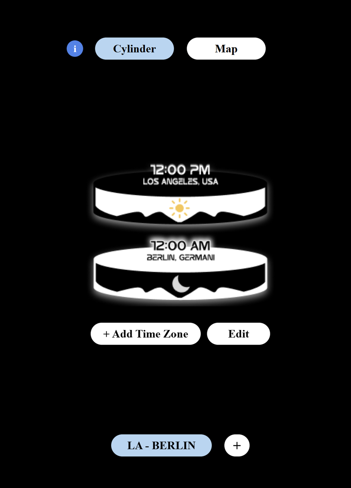
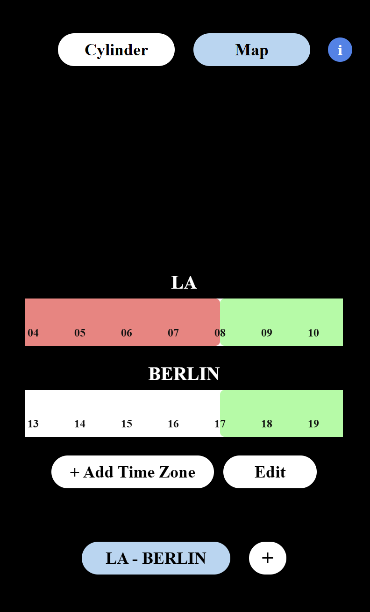

# Timely

A React Native (Expo) app for comparing time zones and finding a time that works for everyone. Add the people or places you keep in touch with, along with their time zone and usual sleep hours, and Timely shows when each one is awake and when everyone overlaps.

  
  &nbsp;
  
  &nbsp;
  

## Two views

- **Cylinder:** each place is a rotating 24-hour cylinder. Set the time for one place and the others show what time it is there, with day and night shading.
- **Map:** each place is a 24-hour timeline, stacked one above the other. Sleep hours are shaded red, and the hours when nobody is asleep are highlighted green, so the best shared time stands out.

## Features

- Add a place with a name, a UTC offset, and bed and wake times, using custom scrolling hour pickers
- Save groups of places as presets and switch between them; long-press a preset to rename or delete it
- Edit or remove places from the map view
- An animated intro screen and a help screen for each view

## Tech

The app's screens and components were designed in Figma first, then built with React Native, Expo (SDK 54), Expo Router, TypeScript, React Native Reanimated and react-native-svg. Both views read from the same shared state through a React context.

## Status

Timely was built as a class project during my senior year at Biola University. The features above were completed, while others were planned for later and never built. It's no longer maintained and runs on an older version of Expo (SDK 54). Places and presets are kept in memory, so they reset when the app restarts, and time zones are whole-hour UTC offsets (-12 to +12).
